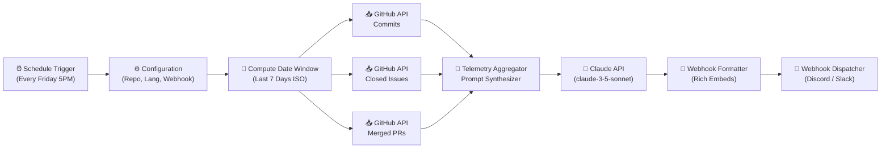

# 🔄 n8n + Claude API: Automated Weekly Dev Summary

> Complete, production-ready n8n workflow that fetches GitHub repository activity (commits, closed issues, merged PRs) and synthesizes a high-signal narrative engineering digest using the Claude API, broadcasting via Discord/Slack webhook.
>
> Solves **Bounty #5** ($200 USD) for [claude-builders-bounty](https://github.com/claude-builders-bounty/claude-builders-bounty).

---

## ⚡ 5-Step Quickstart Setup

### Step 1: Import the Workflow
1. Open your n8n workspace (self-hosted or n8n Cloud).
2. Click **Workflows** → **Add Workflow** → **Import from File...**
3. Select [`github-weekly-claude-summary.json`](github-weekly-claude-summary.json).

### Step 2: Configure Anthropic API Credentials
1. In n8n, navigate to **Credentials** → **New Credential** → **Header Auth** (or set environment variable `ANTHROPIC_API_KEY`).
2. Add your Anthropic API Key (`sk-ant-...`).

### Step 3: Set Repository & Webhook Variables
Open the **Configuration Variables** node in the workflow and customize:
- `GITHUB_OWNER`: Your GitHub organization or username (e.g. `claude-builders-bounty`)
- `GITHUB_REPO`: Your repository name (e.g. `claude-builders-bounty`)
- `TARGET_LANGUAGE`: `EN` (English), `FR` (French), or `ZH` (Chinese)
- `WEBHOOK_URL`: Your Discord or Slack incoming webhook URL
- `LOOKBACK_DAYS`: `7` (default: past 7 days)

### Step 4: Test Execute Workflow
1. Click **Test Step** or **Execute Workflow**.
2. Verify that GitHub commits, issues, and PRs are fetched and that Claude generates a structured narrative digest.
3. Check your destination Discord/Slack channel for the delivered summary.

### Step 5: Activate Schedule Trigger
Toggle the workflow switch to **Active** (🟢). The cron trigger is configured for **Every Friday at 5:00 PM UTC** (`0 17 * * 5`).

---

## 🏗️ Workflow Architecture

---

## ⚙️ Configuration Reference

| Variable | Type | Default | Description |
|---|---|---|---|
| `GITHUB_OWNER` | String | `claude-builders-bounty` | GitHub owner or organization |
| `GITHUB_REPO` | String | `claude-builders-bounty` | Target repository |
| `TARGET_LANGUAGE` | String | `EN` | Digest output language (`EN`, `FR`, `ZH`) |
| `WEBHOOK_URL` | String | *(Your Webhook)* | Destination Slack or Discord webhook endpoint |
| `CLAUDE_MODEL` | String | `claude-3-5-sonnet-20241022` | Anthropic model identifier |
| `LOOKBACK_DAYS` | Number | `7` | Activity window in days |

---

## 🧪 Real-World Sample Output

See [`examples/SAMPLE_WEEKLY_SUMMARY.md`](examples/SAMPLE_WEEKLY_SUMMARY.md) for a real narrative summary generated from live repository telemetry.

---

## 📄 License
MIT License.
